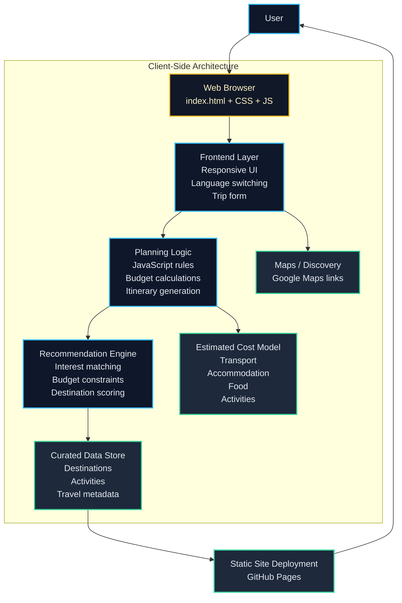

# Architecture Overview

This project is a static, client-side travel planner for Karnataka. The architecture is intentionally simple and lightweight, with no backend service required for the current prototype.

## How the system works

1. The user interacts with the web interface in the browser.
2. The front-end form collects trip inputs such as city, budget, duration, travel interests, and number of travelers.
3. JavaScript logic processes those inputs and applies recommendation rules.
4. The recommendation engine matches user preferences against curated destination data.
5. The app calculates an approximate budget and generates a day-wise itinerary.
6. Users can open destinations in Google Maps for additional exploration.
7. The site is deployed as a static application on GitHub Pages.

## Core design principles

- Simple client-side architecture
- No server-side API dependency required
- Fast static hosting for easy deployment
- Rule-based recommendation logic for prototype use
- Bilingual interface support for Kannada and English
